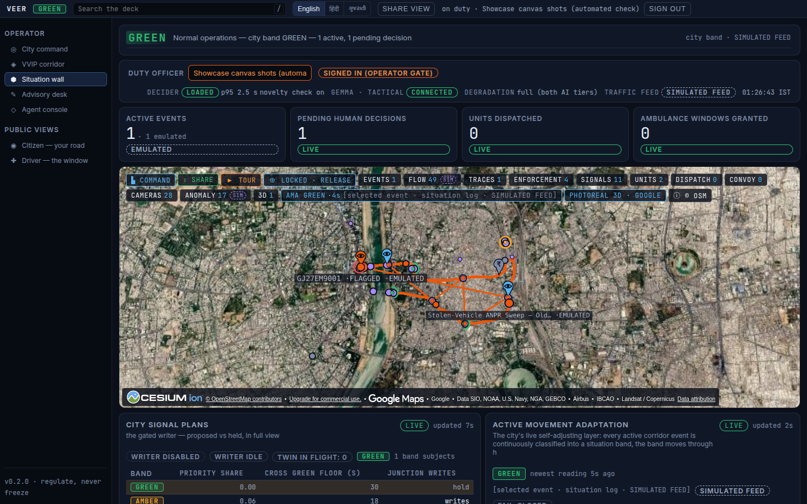
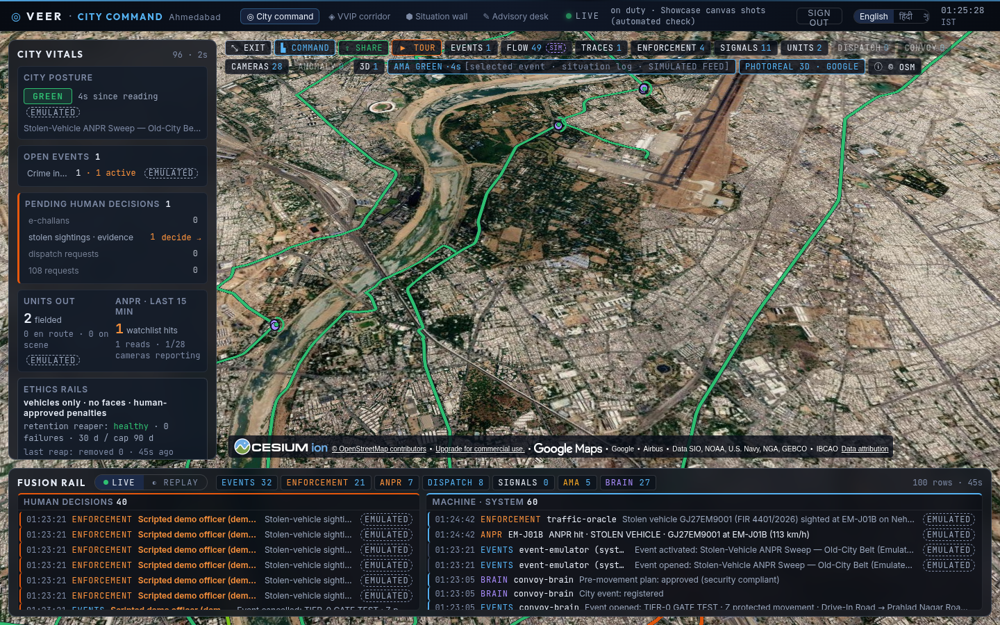
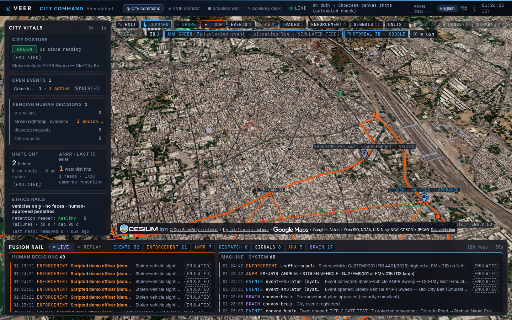
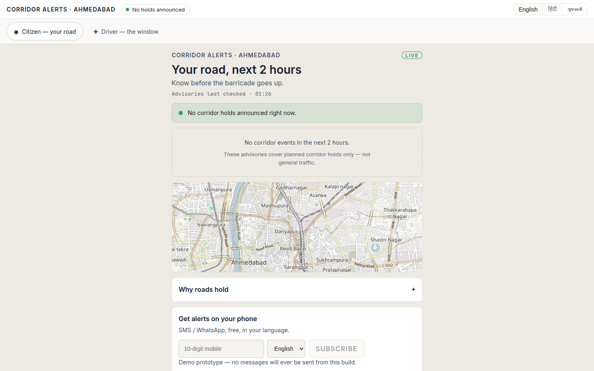

<p align="center">
  
</p>

<h1 align="center">
  🚨 Veer — the City-Scale Corridor-and-Enforcement Operating System
</h1>

<p align="center">
  <strong>Born as the VVIP Convoy Orchestration Platform — and elevated by the paradigm
  shift our mentor pushed us to take seriously: VVIP routing is <em>one component among
  many</em>. One engine now schedules, predicts and releases road-network occupancy for
  eight corridor-event classes (protected movements, processions, mass gatherings, races,
  ceremonials, stadium egress, flood evacuations, work zones), carries a stolen-vehicle
  report from FIR to ranked interception plan on the same rails, and puts every agency on
  one live God's-eye picture. The VVIP run is the base case, not the boundary
  (<a href="docs/USE_CASES.md">the use-case library</a> ·
  <a href="docs/GODS_EYE_INTEGRATION.md">the God's-eye canvas</a>).</strong>
</p>

<p align="center">
  <em>Modelled 25×–506× (central 100×) reduction in junction-freeze commuter delay — deterministic impact model over the platform's real-road network, every assumption falsifiable in <code>IMPACT_REPORT.md</code></em>
</p>

<br/>

<p align="center">
  
  
  
  
  
  
  
</p>

<br/>

<p align="center">
  <a href="#-the-problem">The Problem</a> •
  <a href="#-the-solution">The Solution</a> •
  <a href="#-the-use-case-library--two-mission-families">Use-Case Library</a> •
  <a href="#-the-intelligence-stack">Intelligence Stack</a> •
  <a href="#-how-it-works">How It Works</a> •
  <a href="#-key-capabilities">Key Capabilities</a> •
  <a href="#-system-architecture">Architecture</a> •
  <a href="#-project-structure">Project Structure</a> •
  <a href="#-getting-started">Getting Started</a> •
  <a href="#-technical-documentation">Tech Docs</a>
</p>

---

<br/>

<p align="center">
  
</p>
<p align="center">
  
</p>

## ⚡ The Interface — one command-deck, every audience

**The canonical interface is the SvelteKit command-deck at
`http://127.0.0.1:5273`** — opened in a browser on the GB10 box itself
(container `vvip-argus-command-deck`). `/` is the **Convoy Command
cockpit** (the restored VVIP template home) and `/ops` the situation wall
beside it; operators **sign in by name with the duty PIN** (the operator
gate), and every officer action from then on is recorded under that name.
Every audience lands on the same deck:

| Surface | Route | Theme | What it is |
|---|---|---|---|
| **Convoy Command** | `/` | `command` (graphite) | The cockpit: full-bleed God's-eye canvas, the two-tier planner with its RECOMMENDED ribbon, the officer-gated escort and its HUD — where an **AI proposal waits for the officer's APPROVE / REJECT** |
| **Situation wall** | `/ops` | `command` | Band masthead (city state RED/AMBER/GREEN/BLACK), Corridor Operations Board, Pursuit & Watchlist console, Decision Queue (human approvals — e-challans, stolen-vehicle sightings, escort proposals), Jan Rakshak Dispatch, City Signal Plans, the AMA module card, the Decision-Audit Stream — and the wall God's-eye canvas |
| **God's-eye cinematic** | `/gods-eye` | `command` | The fullscreen CesiumJS city — **photorealistic 3D Ahmedabad for signed-in operators** (Google Photorealistic 3D Tiles + Cesium World Terrain + Bing aerial imagery) with its overlays draped on the city, eleven integrity-validated layers, FLIR-class sensor modes, share links |
| **Citizen Advisory** | `/citizen` | `daylight` (paper) | Public, no sign-in: plain-language band strip + event cards — which stretch, when, how long, the alternate; emulated events badged SIMULATED FEED · EMULATED, never LIVE |
| **108 Green Corridor** | `/driver` | `daylight` | Public: request → awaiting the duty officer → approved by a named officer on `/ops` → open window with live countdown and the golden-hour counter (with no live event up, a labelled scripted fallback walks evaluating → proposal instead) |
| **Comms desk** | `/comms` | `command` | Trilingual advisory columns — EN / हिंदी / ગુજરાતી carrying the same facts verbatim |
| **Chat console** | `/chat` | `command` | Operator chat with the two-tier brain — answers grounded in the city picture, map moves offered as suggestions the operator applies |

Per-surface acceptance is a camera, not a claim:
`services/command-deck/tests/screens-verify.mjs` photographs **six
surfaces — `/ops`, `/gods-eye`, `/citizen`, `/driver`, `/comms`, `/chat` —
under SwiftShader software-WebGL and proves each page's key elements plus a
non-blank PNG** (the cockpit `/` is held by `tests/design-smoke.mjs`; the
camera drives `/driver` end to end only in
its labelled scripted fallback; on a live deck it checks the idle request
card and never files a 108 request) — **40/40 checks green** (re-executed
on the live deck on 2026-10-24 at 00:21 IST, exit 0, `/driver` in its
scripted fallback; manifest:
`tests/artifacts/screens/screens_manifest.json`, shots
`tests/artifacts/screens/screen_{ops,gods-eye,citizen,driver,comms,chat}.png`;
the hero screenshots on this page were recaptured on the live stack the
same night — the operator views in photorealistic 3D).

> **Demo honesty note:** the deck is the backend-wired canonical surface,
> running against the live stack on the box. The React `frontend/` is
> retained **only as the offline fallback demo**: `cd frontend && npm
> install && npm run dev` boots a clearly-labelled scripted full-escort
> simulation (rolling congestion, diversions, AI reasoning panels) that
> needs no GPU and no backends. It is no longer part of the acceptance
> ladder. When the stack is up, use the deck.

### 🎥 The flagship: "God's Eye Morning" (live stack)

`scripts/showcase_run.sh` (no arguments) injects the flagship composite
scenario through the **event emulator's real HTTP API into the running
stack**: 09:20 on the real 148th Rath Yatra morning (27 Jun 2025) — chariots
crawling the old city, an 18 mm/h monsoon burst waterlogging the Nehru Bridge
approach, bazaar crowds behind barricades — and a 108 cardiac ambulance
requesting a green corridor across the river. Into that morning a **stolen
vehicle is reported** (FIR 4401/2026, Kalupur PS, plate GJ27EM9001) and the
enforcement chain runs through the same stack: plate **earmarked** (lawful
basis + 30-day retention) → **emulated ANPR sightings** (every row born
`source='emulated_anpr'`) → because the car is reported stolen, each read
becomes an **evidence-only stolen-vehicle sighting — never a fine on the
owner, who is the victim** (an e-challan approval on that plate is refused,
409) → a **named duty officer approves the sighting**, which authorises
the pursuit → **pgRouting interception plan** (choke junctions ranked off
the latest sighting) → **live trace on the God's-eye canvas** — while a
**Jan Rakshak unit** is dispatched to the spillover and the **city
signal-policy guard** refuses an uncalibrated commit, audited. In the judged
demo every approval is made live by a signed-in human on `/ops`; the script
stops at PENDING wherever a gate does not truly need one.

**Run live on the deployed stack on the night of 2026-10-23/24 —
SHOWCASE PASS three times** (once alone at 23:51 IST, then twice under the
repetition gate, whose two rounds left identical canonical end states).
The artifacts in `showcase/` are the gate's last round, one run (summary
2026-10-23T18:31Z = 00:01 IST on 2026-10-24, exit 0, `passed: true`):
761/761 + 583/583 emulator frames delivered; **31 audited decisions** (25
situation + 6 parameter); 1 band transition (AMBER → RED; the city band
GREEN again once the event ended); the 108 escalation (TAKEOVER, handoff
to the operator); the twin's audited schedule carried the scenario's **4
green-corridor windows** (scripted 108 crossings — causes, not engine
grants) and its 12-replication ambulance-delay mean was **231.92 s**
(model output). The stolen plate's **6
emulated ANPR reads** (EM-CAM-01..04, EM-J01B, EM-J05 at 95–115 km/h,
`source=emulated_anpr`) became **`R_STOLEN_SIGHTING` ×6 — evidence only,
the e-challan withheld** (0 penal recommendations; an e-challan approval
on the plate refused, 409); the newest sighting, approved by `Scripted
demo officer (showcase script)`, authorised the pursuit; **10 choke
junctions ranked** (top: junction 15, unsignalised, score 0.008683) and a
12-position live trace (its 24 h window held these 6 reads and the 23:51
run's 6); the scripted pursuit was closed at run end, so its
approval is spent (one approval, one pursuit); JR-EM-01 dispatched end to
end; the signal-policy guard refused the uncalibrated commit (409
`shadow_eval_failed_closed` — the calibration replay is `no_data`: no
field observations). No fine anywhere in the chain.

**The hero shots recaptured** on 2026-10-24 at 01:25–01:26 IST on the
live stack in its clean, staged judging state (after `demo_reset.sh`),
the three operator views on `PHOTOREAL 3D · GOOGLE`: the 3D city at rest
(110 entities), the pursuit-trace camera on the stolen vehicle's trace
centroid (EMULATED reads; the trace as it stood at capture, a 13-point
trace — the run's had 12 positions; its pins read
`STOLEN · NO FINE · APPROVED` and, on the e-challan a rehearsal script
approved on 2026-10-18 under a cast officer name, before the
stolen-vehicle rule, `SUPERSEDED · STOLEN`) and the `/ops` wall (band
GREEN, one pending decision) — plus the public citizen advisory on its
keyless Daylight map (the deck's public projection, the same for every
visitor: no pursuit, no plate, no event card — the staged sweep is
operator-only). Evidence lands in `showcase/`.
The emulated/real split is stated plainly in
[`docs/USE_CASES.md`](docs/USE_CASES.md) and
[`docs/GODS_EYE_INTEGRATION.md`](docs/GODS_EYE_INTEGRATION.md): the emulator
injects **causes only** (schedules, weather, incidents, requests, ANPR
reads) through real APIs; every decision, band transition and escalation
quoted above was made by the real stack, and every approval in the run
was the script's, recorded as `Scripted demo officer (showcase script)` —
in the judged demo a signed-in human makes every approval. History, kept:
the artifacts before this run (2026-10-18) predated the real roads and
the stolen-vehicle rule — their pursuit stood on an e-challan the script
had approved under a cast officer name, exactly what the platform now
refuses ([`TECHNICAL_DOCS.md`](TECHNICAL_DOCS.md) §13).

---

## 🔴 The Problem

> *"Every day across India's cities, thousands of commuters are stranded — sometimes for 30–45 minutes — as roads are locked down far in advance for VVIP convoy passages."*

When a high-security convoy moves through a city corridor, the current protocol is blunt and manual:

| Current Reality | Impact |
|---|---|
| 🚫 Roads blocked **15–45 minutes** before convoy arrival | Massive traffic queues stretching kilometers |
| 📞 Coordination happens over **phone calls & radio** | Delays, miscommunication, missed signals |
| 🗺️ Routes chosen by **experience, not data** | Sub-optimal paths through congested zones |
| 🚑 Emergency vehicles **cannot request corridor access** | Ambulances stuck behind security blockades |
| 👮 **Five agencies** coordinate without shared visibility | Traffic police, transport, security, municipal, emergency — all disconnected |

The cost is enormous: **gridlocked cities, delayed emergency response, frustrated commuters, and exhausted security personnel** — all because convoy planning relies on decades-old manual coordination methods.

<br/>

## 💡 The Solution

**Veer** (the repo keeps its birth name, VVIP) is an intelligent
edge-deployed, city-scale multi-agency platform that transforms corridor
operations — for protected movements **and public events alike** — from
reactive road-blocking into **predictive, AI-optimized corridor
management**, and carries everyday enforcement work (stolen-vehicle
watchlists, ANPR reads, e-challans, pursuits) on the same auditable rails
with a human in every penalty loop.

Instead of shutting down roads 30 minutes early, the platform:

- 🧠 **Forecasts** traffic conditions 5–30 minutes ahead — today through **t0-alpha**, a third-party zero-shot ONNX INT8 foundation forecaster (Apache-2.0) baked into the oracle image and reading the synthetic feed's history, with a heuristic cache as the last rung; our own DSTGAT architecture is implemented in real PyTorch, but **no trained DSTGAT weights ship yet** (`models/onnx/` is empty — see the honesty note under Neural Traffic Forecasting)
- 🛣️ **Optimizes** convoy routes on request — an OR-Tools optimum plus pgRouting k-shortest alternatives (up to 5 candidates by default), each scored for time, disruption, security and complexity
- ⏱️ **Activates diversions just 60–180 seconds before** the convoy reaches each segment — not minutes
- 🤖 **Runs a two-tier AI command mind** — a 27B strategic **decider** that owns strategy and tool selection, and a Gemma 4 12B **tactical** tier that drafts tool arguments and composes the operator-facing narrative (dossiers, advisories, chat answers; a deterministic heuristic floor answers when it is down) — both resident on the edge box, no cloud
- 🛰️ **Renders one God's-eye city canvas** — photorealistic 3D Ahmedabad for signed-in operators (Google Photorealistic 3D Tiles over Cesium World Terrain) with its overlays draped on it — corridor events, earmarked vehicle traces, signals, agency units, cameras, live congestion — that every agency shares, fullscreen or embedded in `/ops`; public pages stay keyless
- 🗺️ **Runs on Ahmedabad's real roads** — the 49-segment, 34-junction, ~192 km city network is traced on OpenStreetMap (© OpenStreetMap contributors, ODbL 1.0): every segment on the real road of its name, every junction on a real intersection
- 🚨 **Carries the enforcement family** — earmark → ANPR sightings → deterministic recommendations → human approval → operator-initiated pursuit → pgRouting interception plan — vehicles only, lawful basis recorded, retention capped, and **never a fine on a reported-stolen vehicle's owner**
- 🧑‍✈️ **Keeps every decision of consequence with a named human** — penalties, pursuits, dispatches, and every escort route switch the AI proposes (the officer approves each one; no answer in 90 s holds the current plan)
- 📡 **Provides a unified command dashboard** where every agency sees the same live picture

The modelled result on the platform's own real-road network: **junction-freeze commuter delay falls 25×–506× (central case 100×)** under the falsifiable assumptions ledger in `IMPACT_REPORT.md` (a deterministic model, not a field measurement) — the mechanism is structural (delay ∝ hold²), which is why even the conservative bound clears the original "6×" aspiration we no longer lead with because it was unmeasured.

<br/>

## 🗺️ The Use-Case Library — two mission families

The VVIP convoy is the **base case**, not the boundary. Rows 0–7 are the
same failure mode in eight costumes — a corridor whose occupancy must be
scheduled, predicted and released — and the engine expresses them through
one generalized data model (`events.corridor_events`, migration
`services/corridor-store/migrations/007_corridor_events.sql`: five
orthogonal axes — protection class, crowd class, event kind, footprint,
phases — where the kind selects **closure-policy and dossier templates,
never code paths**). Row 8 is the **second mission family**: everyday
enforcement riding the same city backbone.

| # | Corridor event (documented class) | In the engine |
|---|---|---|
| 0 | **VVIP convoy base case** — Z+ state-capital run; 15–45 min blanket holds today | `vvip_convoy_base` · Z+ · full closure 180 s |
| 1 | **Jagannath Rath Yatra** — 148 annual editions, ~14 km old-city procession, lakhs on the street, 35-drone/GPS monitored by 2026 | `rath_yatra_ahmedabad` · procession · 8 km/h speed floor · EXTREME crowd |
| 2 | **Kumbh-class mass gathering** — perimeter ingress/egress around a standing sea of people (240→660 M visits, 2019→2025) | `kumbh_scale_gathering` · pre-dawn medical shuttle · signal hold |
| 3 | **Sabarmati riverfront marathon** — 24,000+ runners, pre-dawn closure → staged crossings → rolling reopen | `riverfront_marathon` · race · 12 km/h pace/sweep |
| 4 | **Republic Day / Independence Day** — Z-class run terminating inside a standing public ceremony | `national_day_parade` · ceremonial · Z · full closure 150 s |
| 5 | **Narendra Modi Stadium egress** — world's largest cricket ground (~132,000 seats); ambulance vs the dispersal wave | `motera_stadium_egress` · egress_surge · seed segment 1032 `stadium_adjacent` |
| 6 | **Monsoon flood evacuation** (Gujarat 2024 class: 28+ dead, 24,000+ relocated) — low-lying arterials vanish, relief columns run the high-ground detour | `flood_evacuation_corridor` · 7 low-lying network segments, the river spine waterlogged |
| 7 | **Metro / bullet-train work zones** — months-long published lane loss (Kankaria Road, Kalupur Bridge) | `metro_work_zone` · standing forced lane-loss · partial closure |
| 8 | **Enforcement: stolen vehicle → ANPR sweep → pursuit** — the second mission family on the same backbone | `watchlist_anpr_sweep` · `crime_incident` + `vehicle_pursuit` event kinds · earmark → reads → evidence-only sighting (no fine) → officer approval → pursuit → interception plan |

Each is a runnable scenario today, on the real road network. Two files
carry them, by design: the digital twin exports the full 23-scenario
library to
`scripts/scenario_library.json` (via `python -m traffic_oracle.simulation
export`), while the event emulator loads its own 10-entry use-case copy —
the 8 corridor use cases + the flagship composite + the emulated ANPR
sweep, `scenarioConfig` only; the `event_kind`/`crowd_class` axes come from
the emulator's hardcoded profiles
(`services/event-emulator/src/event_emulator/use_case_library.json` +
`profiles.py`), which match the twin's values. Each case's documented
reality, Viksit Bharat relevance and engine expression are written up in
**[`docs/USE_CASES.md`](docs/USE_CASES.md)** — including the flagship
composite ("God's Eye Morning": Rath Yatra + monsoon + one ambulance + the
full stolen-vehicle chain) that `scripts/showcase_run.sh` proves end-to-end
on the live stack, and the **God's-eye canvas**
(**[`docs/GODS_EYE_INTEGRATION.md`](docs/GODS_EYE_INTEGRATION.md)**) that
renders both families on one shared 3D picture.

<br/>

---

<br/>
<p align="center">
  
</p>
<p align="center">
  
</p>

## 🧠 The Intelligence Stack

Five tiers, decider at the top, all resident on the one edge box. The
model hosts are systemd `--user` units on loopback (decider `:8083`, Gemma
`:8084`, embeddings `:8085`); the platform services run as the `vvip-argus`
compose project (brain `:8092`, traffic-oracle `:8091`, the event emulator
`:8090`, PostGIS `:56434` with migrations **001–020**, Valkey `:6380`, NATS
`:4223`, the deck `:5273`), host-networked so the loopback model hosts are
reachable — `bash scripts/veer_up.sh --status` prints the 11-row readiness
table:

| Tier | What | Where | Owns |
|---|---|---|---|
| **T5 · Strategic** | `pplx-decider-v1-27b` (BF16, 52,170,802,640 B across 11 shards) | model-host `:8083` | Strategic decisions + **tool selection**, asked as typed `choice`/`noul`/`score` questions — never chat |
| **T4 · Tactical** | `aditi-ps18-v7h` **Gemma 4 12B** (Q4_K_M GGUF, 7,381,382,880 B) | llama-server `:8084` (build 69bf643) | Tool-argument drafting against MCP inputSchemas (1 repair round), dossiers, trilingual advisories, `/chat` narration |
| **T3 · Numeric** | forecast ladder (t0-alpha ONNX INT8 foundation rung → DSTGAT rung, no weights yet → heuristic) · HistGBT ETA (untrained: labelled fallback) · OR-Tools CP-SAT/MIP · pgRouting | traffic-oracle `:8091` | The deterministic tool surface the decider chooses among |
| **T2 · Adaptive** | SituationEngine (deterministic classifier) + hysteresis/escalation/shadow-eval | traffic-oracle `:8091` | Situation class (GREEN/AMBER/RED/BLACK) → protocol-floored movement parameters, published via Valkey |
| **T1 · Embedding spine** | `pplx-embed-v2-late-0.6b` (128-d multivector, MaxSim) + `bge-m3` (1024-d dense) | embedding-service `:8085` | "Similar past situations" memory over incidents and scenario runs |

### How a decision is made — and audited

1. **The decider never runs per GPS tick.** Checkpoints are **event-driven**:
   they fire on (1) incident detection, (2) congestion-threshold crossing,
   (3) an adaptive `situation:changed` notification, (4) phase transitions
   (plan / escort / clear), (5) operator chat — with a ≥5 s per-movement
   rate limit between checkpoints. The live-escort GPS loop itself is
   LLM-free (verified in `workflows/live_escort.py`).
2. **Every decider answer is a distribution.** Each typed answer returns
   `{value, probability, confidence, distribution}` and is appended to the
   movement's `decisions_log` (`memory/convoy_context.py`) — the audit trail
   operators and after-action reports read.
3. **Confidence is gated.** Any answer below the 0.45 confidence floor
   (calibrated 2026-10-19 against the live 27B; env `VVIP_CONFIDENCE_FLOOR`)
   triggers a Gemma draft plus an operator alert instead of being acted on
   directly.
4. **The AI never switches a live escort's route on its own.** During an
   escort the decider only **proposes** a route switch, Plan B, a hold or
   new closures; a named officer approves or rejects each one on the
   convoy HUD or `/ops`, and a proposal nobody answers in 90 s (configurable
   15–600 s) expires — the convoy **holds its current approved plan**.
   That is the human-veto guarantee (`TECHNICAL_DOCS.md` §16.2).
5. **Degradation is explicit.** If `/decider/health` p95 exceeds 3 s, the
   brain drops to Gemma-only tactical mode and raises an operator alert —
   every transition audit-logged.
6. **The fallback chain is total:** decider → Gemma → deterministic
   heuristics. No tier failure stops the convoy.

### Measured (bench re-executed for the interface revision, 2026-10-13 18:54 IST, `scripts/bench_results.json`) — gaps listed, not smoothed

*Timezone note: dates labelled IST are local (UTC+5:30); artifact
timestamps quoted alongside are UTC — the same instants.*

Decider **455.78 tok/s** (p99 **1106.8 ms**) · Gemma **20.09 tok/s** ·
embeddings **92.7 ms** · **62.73 GiB** resident across the stack on the
121.6 GiB GB10 unified-memory pool (`/proc/meminfo` MemTotal 127,533,980 kB) — **19/19 adversarial scenarios
passed (score 100)**, avg **29.19 s** / max **57.38 s** per scenario, every
one under the 60 s scored line (`scripts/bench_adversarial_report.json`,
2026-10-13T13:24:26Z — the run that produced the quoted
`bench_results.json`). Run history in the same harness, no number rounded
in this repo's favour: round 1 (2026-10-11) measured 496.63 tok/s /
958.8 ms / 21.2 tok/s / 92.1 ms / 62.61 GiB with **0/14** scenarios (9×
HTTP 504 at the 120 s cap; 5 evaluator crashes); the post-fix round 2
(2026-10-12, `bench_adversarial_report.r1fix.json`) measured 492.77 tok/s /
968.2 ms / 21.36 tok/s / 84.4 ms / 62.66 GiB with **14/14** (avg 29.27 s /
max 52.03 s); a 2026-10-12T19:50Z re-run went 14/14 at 539.76 tok/s /
888.6 ms / 22.69 tok/s / 91.7 ms (avg 29.32 s / max 56.02 s); the suite
then **grew 14 → 19 scenarios** with the five watchlist/enforcement
scenarios (`tests/adversarial/config.py`: 14 routing + 5 watchlist in the
headless standard run; 2 stress scenarios defined for the stress mode) —
the 2026-10-13T04:09Z run passed **19/19** at 548.59 tok/s / 861.3 ms /
24.04 tok/s / 82.4 ms (avg 25.73 s / max 69.99 s — one scenario over the
scored 60 s line, recorded because it is true; *its report file was later
overwritten, so those figures are doc-only history*); the 2026-10-13T04:33Z
docs-pass run went 19/19 at 546.42 tok/s / 866.0 ms / 23.29 tok/s /
85.9 ms (avg 25.98 s / max 47.6 s); and the interface-revision re-run
quoted above went 19/19 again with every scenario under the line — slower
tok/s and higher p99 than the morning runs, reported exactly as measured.
*(The `bench_results.json` `"round"` label is the script's hard-coded
counter, not a run count.)* The round-1 → round-2 fix landed at the
source (grammar-constrained generation, per-call token budgets and wall
clocks, a decider health-probe latch fix, and the bench client's own
`str` coercion) with **no evaluation threshold touched**.

**Tests and gates on this tree (wave 4).** The gate venv collects
**2709 pytest tests** — convoy-brain 635, corridor-store importer 22 +
store 107, embedding-service 113, event-emulator 328, traffic-oracle 1500,
plus the command-deck's own 4 proxy-guard tests — and signal-ingress's
`cargo test --locked` passes **120/120** (both re-run on the deployed tree
on 2026-10-24, after the tier-0 fix: every pytest suite whole — 2624
passed, 85 skipped themselves for want of an optional dependency or a
scratch store (a database, a Valkey) — the collection by the consistency oracle's own
discovery, cargo in `rust:alpine` on a clean target directory). The acceptance ladder `scripts/verify_all.sh` runs
OFFLINE by default — scripts-syntax, gods-eye-check, gods-eye-canvas,
design-smoke (`/` IS the Convoy Command cockpit), deck-ui (the hermetic
ops-wall smoke incl. the plate-masking group, the contract and unit
tests), every pytest suite run whole, cargo, display-geometry,
ingress-segments, submission-consistency, then the six wave tiers — and
`--live` signs in to the deck once through `scripts/deck_session.sh`,
then runs the `demo_reset.sh` dry-run, the live deck smokes and the live
model tiers. **On the deployed live stack (2026-10-23/24)** both ran green
inside the 22-step live acceptance — 19 steps green first time; the
tier-0 gate and two canvas smokes failed, were fixed (the decider's route
options keyed on their own segments, a pre-movement answer also filed
under the movement's own decision doc; the acceptance debris cleared by
the pre-judging reset) and their failed checks re-ran green
([`TECHNICAL_DOCS.md`](TECHNICAL_DOCS.md) §13). History, kept: the
2026-10-17/18 waves drove the then-ladder green after one fix round
(`verify_all.sh` ALL TIERS PASSED; `showcase_run.sh` SHOWCASE PASS,
2026-10-18T15:01Z; `bench_stack.sh` BENCH OK, the run quoted above), and
the screens camera passed **40/40** against the then-live deck. *(The
earlier 127 exits of the gate scripts in the 2026-10-12 repair session
are history, kept visible in `TECHNICAL_DOCS.md` §3/§13.)*

**What the waves added, briefly:** the 2026-10-17/18 gate waves brought the forecaster out-of-support hatch
(`predict/support_bounds.py`: no model ever sees an out-of-support input),
the decider novelty latch (confident-but-novel checkpoints abstain with an
audit row), the model-drift panel, the t0-alpha ONNX INT8 foundation rung
behind the hatch (`models-local/t0`), P90-robust routing
(`optimize/quantile_objective.py`) with banded ETAs, the decider tier-0
routine-checkpoint cache (`DECIDER_TIER0_DISABLE` kill switch), the
**degradation ledger** (`GET /api/v1/ops/degradation-taxonomy` + the deck's
DegradationLedger panel on `/ops`) and the **repetition gate**
(`scripts/repetition_gate.sh`: identical showcase terminal DB state across
restored rounds — `--fast` in the ladder, the full live gate on demand);
the work-package waves that followed (WP-01…WP-19) built the city-fusion
spine, the honest live data plane, the stolen-vehicle rule, route updates,
synthetic history kept apart, the God's-eye reconstruction, the operator
gate and the one-command bring-up; wave 4 (WP-20…WP-22, WP-15) put the
network on real roads, gave the officer authority over every escort
switch, took the God's-eye to photorealistic 3D and re-proved the docs; the
live pass (2026-10-23/24) deployed it, ran the acceptance on the live
stack, fixed the tier-0 cache keying it exposed (pre-movement route
options are now labelled by their own segments, and a pre-movement answer
is also filed under the movement's own decision doc) and regenerated the
flagship figures and hero shots from the live runs. Full detail:
`TECHNICAL_DOCS.md` §3, §6.1b, §13 and §16.

**Still open, published as-is:** tool_validity **0.684** (up from 0.643;
the decider often final-answers after one tool where a scenario expects
two) and keyword_coverage **0.561** (it moves run to run — 0.595, then
0.579, then this) — both pass the gate but are tracked quality gaps, not
hidden; reasoning_depth 0.30–0.41 across runs.

<br/>

---

<br/>

## 🎯 How It Works

The platform operates in three distinct phases — each AI-assisted, with every decision of consequence left to a named officer:

<br/>

### Phase 1 — Pre-Movement Planning 📋

> *Minutes to hours before the convoy departs*

```
  📍 Origin & Destination Defined
         │
         ▼
  🛰️ Traffic Conditions Analyzed
         │  ← Live feeds + historical patterns + anomaly detection
         ▼
  🗺️ Multiple Routes Scored
         │  ← Time (30%) + Disruption (40%) + Security (20%) + Complexity (10%)
         ▼
  🔒 Security Validation
         │  ← Lane requirements, closure types, crowd risk assessment
         ▼
  📋 Diversion Plan Generated
         │  ← Per-segment timing, agency assignments, activation schedules
         ▼
  ✅ Plan Approved — Ready for Execution
```

The decider takes a strategic checkpoint here (≤1500-token state document)
and answers typed questions — route strategy as a `choice`, urgency as a
`noul` probability, disruption tolerance as a `score` — before any route is
locked. The tactical tier validates every candidate route against security
classification rules: a Z+ convoy (highest security) requires 6-lane roads
with full closure capability, while a Y-class movement only needs signal
priority. Routes that violate constraints are rejected **with the reason
attached**.

<br/>

### Phase 2 — Live Escort 🚔

> *Live convoy tracking and an officer-approved response*

As the convoy moves:

- **GPS tracking** updates convoy position every second (adaptive 1–5 s; no GPS hardware feeds this deployment, so an escort walks its approved route on a labelled EMULATED GPS) — the tick loop is pure numeric code, **no model calls**
- **Live traffic ahead** — the escort reads the live congestion cache on the route segments within 3 km of the convoy; the T+5/10/15/30-minute forecasts are a planning tool the decider can call
- **Diversions activate** as the convoy approaches each road segment, inside the class's protocol-floored advance window
- **Congestion spikes** crossing the adaptive threshold trigger a decider checkpoint — only then — and tactical agents fire **only on incidents**; any route change the decider wants becomes a **proposal** a named officer approves
- **Signal priority** is planned for the convoy's path as diversion directives — the city signal-plan writer is gated (default OFF, operator-triggered, fail-closed until the twin is field-calibrated), and no field signal controller is connected today
- **Emergency requests** from ambulances land in the duty officer's Decision Queue, and a named duty officer approves each corridor window

<br/>

### Phase 3 — Post-Clearance Recovery 🔄

> *After the convoy passes — bringing the city back to normal*

Most convoy systems stop at escort completion. This platform goes further:

- **Diversions deactivate** segment-by-segment as the convoy clears each zone
- **Recovery monitoring** tracks how quickly traffic returns to normal flow
- **Congestion analysis** identifies which segments are still jammed and why
- **After-action reporting** summarises the movement — escort duration, segments affected and recovered, recovery time, diversions lifted, and the counts of alerts and audited decisions (each decision, with its distribution and confidence, stays in the movement's `decisions_log`)

<br/>

---

<br/>

## 🏗️ Key Capabilities

### 🧠 Two-Tier AI Decision Making

The platform's mind is a **strategic decider (27B) on top of a tactical
composer (Gemma 4 12B)** — both running locally on the edge device: no
cloud model call and no internet connection anywhere in the decision path
(only the God's-eye map imagery is fetched from the internet — see Edge
Deployment).

Four specialized tactical agents run on Gemma under decider supervision:

| Agent | Role | Think of it as... |
|---|---|---|
| 🔍 **Traffic Analyst** | Reads the road — congestion patterns, anomalies, trends | *"The intelligence officer scanning the terrain"* |
| 🗺️ **Route Planner** | Finds the best path — scores, ranks, and recommends routes | *"The navigation expert with a chess player's foresight"* |
| 🔒 **Security Liaison** | Validates compliance — lane widths, closure types, crowd risks | *"The security chief ensuring protocol compliance"* |
| 📡 **Diversion Coordinator** | Orchestrates ground ops — agency assignments, timing, sequences | *"The field commander coordinating five agencies simultaneously"* |

The decider picks which tool each agent calls next; Gemma drafts the
arguments against the tool's declared inputSchema (with one repair round);
the numeric tier computes. Every answer carries a probability distribution
and confidence that lands in the movement's audit log.

<br/>

### 🛣️ Intelligent Route Optimization

Routes aren't picked randomly or by shortest distance. The optimizer evaluates every candidate on four weighted dimensions:

| Factor | Weight | What It Measures |
|---|---|---|
| **Travel Time** | 30% | Predicted travel duration using ML forecasts |
| **Traffic Disruption** | 40% | How many commuters will be affected |
| **Security Compliance** | 20% | Road class, lane count, known risk zones |
| **Route Complexity** | 10% | Number of turns, signals, junctions |

The adaptive tier may reweight these per movement from the live situation
class — always protocol-floored, always fail-closed to these baselines.

<br/>

### 📊 Neural Traffic Forecasting (architecture real; weights not yet shipped)

The **DSTGAT** (Dynamic Spatio-Temporal Graph Attention Network) is the
forecasting architecture:

- **4 forecast horizons**: 5, 10, 15, and 30 minutes ahead
- **Graph-aware**: designed to learn how congestion on one road affects neighbouring roads
- **Temporal patterns**: designed to learn daily and weekly rhythms — morning rush, evening rush, weekend patterns — once trained on field data
- **Anomaly detection** sits beside it, not in it: the ingress feed's Tier-1 checks flag unusual readings inline as they arrive, and the oracle logs them (an Isolation Forest detector exists in the oracle's code but is not wired into the live path)

> **Honesty note (verified in-repo):** the DSTGAT PyTorch/ONNX *code path* is
> real, but **no trained DSTGAT artifact ships in this repository** —
> `models/onnx/` contains only `.gitkeep`, and the runtime default
> `ONNX_MODEL_PATH` points at a not-yet-present
> `models/onnx/flow_forecaster.onnx`, so the DSTGAT rung stays dormant. The
> forecasts the oracle serves today come from the rung ahead of it:
> **t0-alpha**, a third-party zero-shot foundation forecaster (ONNX INT8,
> Apache-2.0, sha256-pinned in `models-local/t0/NOTICE`) that the oracle
> image bakes in (`VVIP_FOUNDATION_MODEL_PATH`) — kept out of git, and
> reading the synthetic feed's own history; until that history is warm,
> or for an input outside its support, the forecaster falls back to its
> labelled heuristic/cache rung (`TECHNICAL_DOCS.md` §6.1b). The ETA and
> anomaly models (scikit-learn) ship no trained artifacts either: their
> training code exists (joblib persistence), but nothing trains them on
> the live path today — the ETA endpoint answers with its labelled
> fallback (`model: fallback`) and the Isolation Forest is not wired in. The road
> network is real (OpenStreetMap), but every traffic observation in this
> repo — and every row the ingress publishes today — is synthetic and
> labelled `data_quality: synthetic`; no real traffic records are bundled.

<br/>

### 🧭 Active Movement Adaptation (the named AMA module, R9)

A deterministic SituationEngine classifies every movement's world —
security tier × traffic regime × weather × crowd density, plus anomaly and
event flags — into GREEN / AMBER / RED / BLACK. Because the scoring is
monotone in every input, worsening any single dimension can never soften
the band, and a Z+ movement is never classified below AMBER. Class
transitions publish `situation:changed`, which is one of the five events
that legitimately wake the decider. The module is **named and surfaced as
the Active Movement Adaptation (AMA) module** — six stages (situation →
hysteresis → protocol floors → twin shadow-eval → audited persistence →
city signal plans), rendered as a module card on `/ops`
(`AMAModuleCard.svelte`), as a band chip on the God's-eye canvas, and as
machine-readable data at `GET /api/v1/adaptive/module`:
**[`docs/ACTIVE_MOVEMENT_ADAPTATION.md`](docs/ACTIVE_MOVEMENT_ADAPTATION.md)**.

<br/>

### 🛰️ The God's-Eye City Canvas — real 3D Ahmedabad

The shared picture five hierarchies never had: a CesiumJS city embedded
as the centerpiece of `/` and `/ops` and as the fullscreen `/gods-eye`
cinematic. **Signed-in operators see photorealistic 3D Ahmedabad** —
Google Photorealistic 3D Tiles over Cesium World Terrain with Bing aerial
imagery, keyed by the deck's Cesium ion token, which is handed only to a
signed-in session — with its overlays **draped on the 3D city**: the
live congestion network on the 49 real roads, event spines (the
RECOMMENDED corridor glowing, alternates dashed), the pursuit trace and
its interception fan, vehicle traces, dispatch arrows, the convoy, camera
sites, signal rings, agency units and anomalies; markers stand at street
level and no building hides them — every overlay layer audits **0
floating** entities on the 3D city, the e-challan pins and the pursuit
included, and the selection halo, the AI's agent notes and the REPLAY of
a recorded run stand on the ground too. City Command opens on a
judge-grade oblique — the live action framed at −42° (measured on the
merged tree: the camera 2.3–2.7 km up; on the live stack: 2945 m), or,
with nothing in action, the
old city and the Sabarmati at −40° — with the Google, Cesium ion and
OpenStreetMap credits on a legible plate above its fusion rail. Anonymous
and public pages stay **keyless** (OSM raster + Veer's own entities, zero ion or
Google calls), and the imagery chip says honestly which one is on screen:
`PHOTOREAL 3D · GOOGLE` once the 3D tiles cover the view, `OSM · DARK`
keyless, `OSM · DARK · FALLBACK` when the ion imagery fails and no 3D tiles cover the view. Verified on
the merged tree with a keyed, signed-in preview: `imageryMode`
`ion-photoreal`, 0 CSP violations, and the ion token served only to a
signed-in operator — and again on the live stack after the deploy
(2026-10-24: every overlay layer 0 floating, 0 CSP violations on
`/gods-eye`, `/` and `/ops`; the hero shots on this page). Eleven integrity-validated layers, FLIR White-Hot /
Black-Hot sensor modes, share links that restore the exact view, the AMA
band chip. Architecture, the measured layer table, the emulated/real
split extended to ANPR, and the ethics rails:
**[`docs/GODS_EYE_INTEGRATION.md`](docs/GODS_EYE_INTEGRATION.md)**.

<br/>

### 🗺️ The Road Network — Ahmedabad's real roads (OpenStreetMap)

The city network every planner, the twin, the cameras, the ingress feed,
the emulator and the God's-eye share is traced on **real OpenStreetMap
roads**: **49 segments, 34 junctions, ≈192 km** (191.76 km measured in the
store by PostGIS), one strongly connected
network — each segment along the real road of its name between two real
intersections (Swami Vivekananda Road, Kasturba Gandhi Road, SH71
(Bhat–Motera Road), Ashram Road, SG Highway, SP Ring Road, the
Gandhinagar Highway, the old-city bazaar belt, Motera Stadium Road …), each
junction on its OSM node. `scripts/gen_osm_network.py` builds it
deterministically from committed Overpass extracts, and `--verify`
re-proves it offline (every segment within 15 m of its OSM centreline —
worst 7.76 m — ending at its junctions, length within 2 %). Migration 020
records the provenance (`geom_source = osm`). Road geometry
© OpenStreetMap contributors, ODbL 1.0.

<br/>

### 🚨 Watchlist & Enforcement (vehicles only, humans in the loop)

The second mission family on the same backbone: a stolen-vehicle FIR
becomes a **lawful-basis earmark** (retention capped at 90 days,
server-computed) → emulated ANPR camera reads (every row born
`source='emulated_anpr'`; the `live_anpr` label is reserved for a real
vendor feed behind the `AnprSource` port) → **deterministic
recommendations** filed PENDING → **a named duty officer decides** with an
append-only audit tail → **operator-initiated pursuit** → **pgRouting
interception plan** ranking choke junctions off the latest sighting.
**A reported-stolen vehicle's owner is the victim, so the platform never
fines them:** under the FIR earmark each read becomes one evidence-only
stolen-vehicle sighting, approving an e-challan on that plate is refused
(409), and the officer's approval of the sighting is what authorises the
pursuit — **one approval, one pursuit**: the oracle refuses (422) a
pursuit of a stolen car based on an e-challan, and a second pursuit from
an approval that already authorised one; `/ops` never offers a spent
approval as the basis. Vehicles only, via ANPR plates — no face, no person, no
person-directed field on any path; plates are **masked** on every surface
until a named officer is signed in; and Jan Rakshak, police, traffic, 108
and fire are dispatchable agencies through the same human-approved,
audited dispatch channel. Camera sites are built to integrate the
state's existing ICCC / CCTV / ITMS inventory — Veer strengthens those
programmes; it does not replace them.

<br/>

### 🖥️ The `/ops` Situation Wall — the operator's wall (the cockpit `/` links here)

The canonical operator surface (`/ops` on the command-deck at `:5273`,
behind the operator sign-in) is a **situation wall** designed for 24/7
control-room operations — a band masthead over twelve panels around the
wall God's-eye canvas (the screens camera counted twelve on the live deck,
2026-10-24, `screens_manifest.json`; ten at its 2026-10-13 capture):

- **Band masthead** — the city's situation band (RED/AMBER/GREEN/BLACK) with
  pending-decisions and units-out counts; it moves with the city (the
  manifest has recorded RED and GREEN on the same masthead across runs)
- **Corridor Operations Board** — every live corridor event as a card
  (23 at the 2026-10-13 capture), each with its freeze window
- **Pursuit & Watchlist** — earmarked plates, emulated ANPR sightings, the
  live pursuit console
- **Decision Queue** — everything that waits **PENDING** for a named duty
  officer: e-challan recommendations, stolen-vehicle sightings (whose
  approval authorises a pursuit), dispatch requests, and the escort lane
  where the AI's route-switch proposals wait for APPROVE / REJECT with
  their expiry countdown
- **Jan Rakshak Dispatch** — the civilian-force dispatch panel
- **City Signal Plans** — the gated signal-plan writer's view
- **Active Movement Adaptation** — the named AMA module card (live
  `/adaptive/module` descriptor)
- **Decision-Audit Stream** — the append-only audit rows as they land
- **Band history** and **Twin Shadow-Eval Comparison** — the hysteresis trail
  and the fail-closed twin gate every non-baseline plan must pass
- **Interception Choke Plan** — the live pursuit's choke junctions, ranked
  off the latest sighting
- **Degradation Ledger** — the recurring causes of degraded or failed
  decisions, each with a real audit row behind it
- **Event Emulator** — the labelled emulator panel (its runs, launch, stop
  and replay)
- **The wall canvas** — the God's-eye 3D city embedded as the centerpiece
  (`.ge-canvas`), with the fullscreen `/gods-eye` cinematic one click away

The retired React dashboard (left planning panel / center map / five-tab
right monitor) lives on only inside `frontend/` as the **offline fallback
demo** — its scripted simulation still runs with no backends.

<br/>

### 🚑 Emergency Corridor Access

A dedicated clearance system allows emergency vehicles to request corridor access during active convoy movements:

- A 108 ambulance driver files a one-tap request on the public `/driver` page (ambulance-only, capped per client); fire, police and Jan Rakshak units are dispatched by an operator through the same audited channel
- The request lands in the duty officer's Decision Queue with its event, stretch and waypoint junction — it never approves itself
- Duty officers can **approve or defer** with one click
- An approved request opens a corridor window timed from the event's hold, with the live countdown on the driver's own page

<br/>

### 🔐 VVIP Security Classification

Four security tiers with distinct operational requirements:

| Class | Description | Road Requirement | Closure Type | Advance-Closure Floor |
|---|---|---|---|---|
| **Z+** | Highest security (Head of State) | 6+ lane roads | Full road closure | 180 s |
| **Z** | High security (Cabinet level) | 4+ lane roads | Partial closure | 120 s |
| **Y** | Medium security (State officials) | 2+ lane roads | Speed restriction + signal priority | 60 s |
| **X** | Standard escort | No restriction | Signal priority only | none (no closure) |

> **Event-agnostic generalization:** the engine's generalized event model
> adds a fifth protection class — **`none`, a public event with no
> protectee** (a procession, a marathon, an egress surge, an evacuation
> column, a work zone) — alongside Z+/Z/Y/X. The base-case machinery
> (protocol floors, adaptive bands, audit trail) applies unchanged; a
> `none`-class Rath Yatra is managed by the same forecaster, router and
> situation engine as a Z+ run, with closure policies chosen per event kind
> (`docs/USE_CASES.md`).

<br/>

### ⚡ Edge Deployment

The entire platform runs on **one GB10-class edge box** (Grace-Blackwell
unified memory, 121.6 GiB pool — `/proc/meminfo` MemTotal 127,533,980 kB)
— no cloud servers, no data center, and no internet connection in the
decision path. Only the God's-eye map imagery comes from the internet: OSM
raster tiles on the keyless canvas, Cesium ion imagery and Google's 3D
tiles for a signed-in operator on a keyed deck; when the tiles stop
loading the canvas says `OFFLINE SCHEMATIC MODE` and still draws Veer's own
entities.

- The 27B decider resident in BF16 (48.58 GiB of weights), Gemma 4 12B Q4_K_M, and both embedders co-resident — the planned budget (`models-config/MEMORY_BUDGET.md`) is ≈82 GiB, leaving ≈40 GiB of the pool
- Nothing is ever evicted; every model host is a systemd unit with `Restart=always`
- Deployable wherever the box can go — motorcade command vehicles, mobile control rooms, field ops centers

The browser demo (`frontend/`) needs none of this — it runs on any laptop.

<br/>

---

<br/>

## 🔧 System Architecture

Six specialized microservices plus three resident model hosts (the
event-emulator is the sixth service — the emulated half, §"Key
Capabilities" and `TECHNICAL_DOCS.md` §2.9):

```
                          ┌─────────────────────┐
                          │   Command Deck       │   SvelteKit :5273 — canonical
                          │   (Presentation)     │   operator PIN gate · 3D God's-eye
                          └──────────┬──────────┘
                                     │
                          ┌──────────▼──────────┐
                          │    Convoy Brain      │   Python :8092 · decider + Gemma
                          │  (AI Orchestration)  │   proposes; officers approve
                          └──┬───────┬───────┬───┘
                             │       │       │
              ┌──────────────▼─┐  ┌──▼───┐  ┌▼──────────────┐
              │ model-host     │  │NATS  │  │Traffic Oracle │  Python :8091 · OR-Tools
              │ :8083 decider  │  │      │  │ (ML Engine)   │  Neural forecasting + routing
              │ 27B strategic  │  │      │  │ + Situation-  │  + adaptive layer
              ├────────────────┤  │      │  └──────┬────────┘
              │ llama-server   │  │      │         │
              │ :8084 Gemma 4  │  │      │  ┌──────▼───────┐
              │ 12B tactical   │  │      │  │  PostGIS     │   49 OSM road segments
              ├────────────────┤  │      │  │  + Valkey    │   pgRouting + pgvector
              │ embedding-svc  │  │      │  │  + DuckDB    │   migrations 001–020
              │ :8085 memory   │  │      │  └──────────────┘
              └────────────────┘  │      │
                          ┌───────▼──────┐
                          │ Signal       │   Rust · Arrow IPC
                          │ Ingress      │   edge-synthetic feeds, labelled
                          └──────┬───────┘
                                 │
                    ┌────────────┼────────────┐
                    ▼            ▼            ▼
              Gov Traffic    Fleet GPS   Crowdsource
                Feeds       Telemetry     Reports

   ┌──────────────────────┐   causes only (never outcomes): corridor events,
   │ event-emulator :8090 │   adaptive inputs docs, ANPR reads, unit frames,
   │ (the emulated half)  │   one twin POST, NATS corridor.traffic.emulated
   └──────────────────────┘   — never .live; every row labelled EMULATED
```

| Service | Language | What It Does |
|---|---|---|
| **Signal Ingress** | Rust | Four traffic-feed adapters with inline Tier-1 anomaly detection over the 49-segment network — edge-synthetic today (no live connector yet), every row labelled `synthetic` |
| **Traffic Oracle** | Python | ML predictions, route optimization, anomaly detection, adaptive situation layer — plus the watchlist/enforcement routers (earmarks, sightings, e-challans, interception plans), the agency dispatch channel and the gated city signal-plan writer |
| **Convoy Brain** | Python | Decider-supervised agent orchestration — the "thinking" layer: planning, the live escort (where the AI only proposes and a named officer approves every switch), chat, MCP |
| **Corridor Store** | PostgreSQL | Spatial database with the real-road network (OpenStreetMap), traffic history, graph routing, memory embeddings, generalized `events.*` schema, vehicle watchlist + city coordination tables (migrations 001–020) |
| **command-deck (canonical UI)** | TypeScript/SvelteKit | The interface for every audience at `:5273` behind the operator PIN gate — `/` Convoy Command, `/ops` situation wall, `/gods-eye` cinematic (3D for signed-in operators), `/citizen` + `/driver` public surfaces, `/comms` trilingual desk, `/chat`. The React `frontend/` is the offline fallback demo, not a service |
| **event-emulator** | Python | The emulated half — injects the use-case library's causes through the real APIs, including emulated ANPR camera reads (`:8090`; `TECHNICAL_DOCS.md` §2.9) |
| **model-host** | Python | Serves the 27B strategic decider as typed questions (`:8083`) |
| **llama-server** | llama.cpp | Serves Gemma 4 12B tactical completions (`:8084`) |
| **embedding-service** | Python | Multivector + dense memory retrieval (`:8085`) |

<br/>

---

<br>

## 📁 Project Structure

```
VVIP/
│
├── 📄 README.md                          ← You are here
├── 📄 TECHNICAL_DOCS.md                  ← Detailed technical documentation
├── 📄 IMPACT_REPORT.md                   ← Measured-model impact (deterministic)
├── 📄 VVIP.md                            ← Original project proposal
├── 📄 LICENSE                            ← MIT License
│
├── 📚 docs/
│   ├── USE_CASES.md                      ← The use-case library (8 corridor classes + the
│   │                                        enforcement family, each with documented reality,
│   │                                        Viksit Bharat relevance, and its runnable scenario)
│   ├── GODS_EYE_INTEGRATION.md           ← The God's-eye canvas: architecture, the emulated/
│   │                                        real split extended to ANPR, the ethics rails
│   └── ACTIVE_MOVEMENT_ADAPTATION.md     ← The named AMA module (R9): six stages, HTTP surface
│
├── 🎨 frontend/                          ← LEGACY React dashboard — the OFFLINE
│   │                                        FALLBACK demo (scripted simulation,
│   │                                        no backends; retired from the gate ladder)
│   ├── src/
│   │   ├── components/                   ← 12 UI components
│   │   │   ├── VVIPDashboard.jsx         ← Root dashboard — toolbar, panels, layout
│   │   │   ├── ConvoyMap.jsx             ← Interactive map with route overlays
│   │   │   ├── LeftPanel.jsx             ← Convoy planning & VVIP profile
│   │   │   ├── RightPanel.jsx            ← Operations monitor (5 tabs)
│   │   │   ├── AIReasoningPanel.jsx       ← Chain-of-thought AI display
│   │   │   ├── NotificationBell.jsx      ← Emergency clearance system
│   │   │   └── ...
│   │   ├── context/ConvoyContext.jsx      ← Global state management
│   │   ├── hooks/useLiveData.js          ← Real-time data subscriptions
│   │   ├── services/api.js              ← Backend API client
│   │   └── views/                        ← Route planning & comms views
│   ├── package.json
│   └── vite.config.js
│
├── 🧠 services/
│   │
│   ├── convoy-brain/                     ← AI Orchestration Engine
│   │   └── src/convoy_brain/
│   │       ├── orchestrator.py           ← Two-tier turn loop + fallback chain
│   │       ├── decider.py                ← Strategic tier: cadence, budgets, degradation
│   │       ├── adaptive_params.py        ← Fail-closed adaptive-parameter client
│   │       ├── http_guard.py             ← Outbound URL safety (SSRF guard)
│   │       ├── llm/
│   │       │   ├── decider_client.py     ← pplx-decider-v1-27b typed-question client
│   │       │   ├── llama_bridge.py       ← Gemma 4 12B tactical bridge (schema ladder)
│   │       │   └── heuristics.py         ← Deterministic floor of the fallback chain
│   │       ├── agents/                   ← 4 tactical agents (+ an unwired community-liaison draft agent)
│   │       ├── workflows/                ← 3 state-machine workflows
│   │       ├── mcp/                      ← 28 MCP tools + 4 resources + 3 prompts (server.py, prompts.py); read-only rail
│   │       └── memory/                   ← Convoy state + decisions audit log
│   │
│   ├── model-host/                       ← T5 strategic tier (:8083)
│   │   └── src/model_host/               ← Loads the 27B decider snapshot
│   │
│   ├── embedding-service/                ← T1 memory (:8085)
│   │   └── src/                          ← multivector MaxSim + dense ANN
│   │
│   ├── traffic-oracle/                   ← ML Prediction & Optimization
│   │   └── src/traffic_oracle/
│   │       ├── predict/                  ← DSTGAT forecaster + ETA model (+ nn/ architecture)
│   │       ├── simulation/               ← Digital-twin engine (twin, scenarios, calibration)
│   │       ├── optimize/                 ← Route optimizer + diversion planner
│   │       ├── adaptive/                 ← SituationEngine + params + escalation
│   │       ├── anomaly/                  ← Tier-1 anomaly stream → anomaly_log
│   │       ├── ingest/                   ← NATS → database pipeline
│   │       └── runtime/                  ← Unified-memory management
│   │
│   ├── signal-ingress/                   ← Rust Real-Time Data Ingestion
│   │   └── src/
│   │       ├── feeds/                    ← traffic data source adapters
│   │       ├── pipeline/                 ← Bounded channel batching
│   │       ├── anomaly/                  ← Tier-1 inline detection (~500 ns target)
│   │       └── publish/                  ← Arrow IPC → NATS streaming
│   │
│   ├── corridor-store/                   ← Spatial Database
│   │   ├── migrations/                   ← 001–020 (PostGIS + pgRouting + pgvector, events,
│   │   │                                   watchlist, city assets, 020 = OSM geom_source)
│   │   ├── seed/                         ← The real-road network (generated from OSM) +
│   │   │                                   synthetic observations; NOTICE.md (ODbL)
│   │   └── importer/                     ← OpenStreetMap → PostGIS loader
│   │
│   └── command-deck/                     ← ★ CANONICAL INTERFACE (SvelteKit, :5273):
│       └── src/                          │   / cockpit · /ops wall · /gods-eye ·
│           ├── hooks.server.ts           ← loopback proxy + operator gate + CSP
│           ├── lib/gods-eye/             ← the CesiumJS city: 11 layers, 3D draping
│           ├── lib/design/               ← tokens.css/tokens.ts — the one design-token
│           │                               contract (command graphite + Daylight)
│           └── lib/ops/components/template/ ← the restored VVIP cockpit parts
│
├── 🎭 services/event-emulator/           ← The emulated half of the corridor stack
│   └── src/event_emulator/               ← Injects CAUSES ONLY (procession schedules,
│       │                                 │   weather onset, incidents, green-corridor
│       │                                 │   requests) through the real stack's real
│       │                                 │   APIs — never outcomes. Serves :8090,
│       │                                 │   consumes the use-case library verbatim
│       └── use_case_library.json         ← The 8 use cases + the flagship composite +
│                                           the stolen-vehicle ANPR sweep (10 entries)
│
├── 🏗️ infra/                             ← Infrastructure & Deployment
│   ├── compose.yml                       ← Docker Compose stack
│   ├── compose.gb10-override.yml         ← GB10 single-host layout (host networking)
│   ├── compose.argus-override.yml        ← THE live stack: project vvip-argus, ports, -argus images
│   ├── systemd/                          ← veer.target: model units + veer-up.service (boot)
│   ├── scripts/serve_models.sh           ← Runs the :8083/:8084/:8085 model hosts
│   ├── docker/                           ← Dockerfiles
│   └── observability/                    ← Prometheus + Grafana (23 alert rules)
│
├── 🧰 scripts/                           ← veer_up.sh (bring-up) · verify_all.sh (gates) ·
│                                           gen_osm_network.py + data/osm/ (the network) ·
│                                           showcase_run.sh · journeys.mjs · demo_reset.sh ·
│                                           impact_run.py
│
├── 🤖 models-config/                     ← Model Stack configuration (the weights live outside git)
│   ├── configs/veer_models.yaml          ← C0: single source of model-stack truth
│   ├── Modelfile.gemma_vvip              ← Ollama debug side-load of the same GGUF
│   ├── MEMORY_BUDGET.md                  ← GB10 unified-memory budget (planned+measured)
│   └── embedding_launcher.py             ← Models-owned embedding service launcher
├── 🤖 models/                            ← weights (a host path) — finetune/ (Qwen-era QLoRA, kept
│                                           for provenance) · onnx/ (EMPTY: see the honesty note)
│
├── 📡 shared/                            ← Cross-Service Definitions
│   ├── proto/                            ← Protocol Buffer schemas
│   └── schemas/arrow/                    ← Arrow IPC data formats
│
└── 🧪 tests/
    └── adversarial/                      ← 21-scenario suite (14 routing + 5 watchlist +
                                             2 stress); the bench's headless standard run
                                             gates on the 19 non-stress scenarios
```

<br/>

---

<br/>

## 🚀 Getting Started

### Prerequisites

| Requirement | Minimum |
|---|---|
| **GPU** | Full stack: GB10-class unified memory (121 GiB pool). Browser demo: any laptop |
| **CPU** | 8+ cores |
| **RAM** | 32 GB (demo) · 121 GiB unified (full stack) |
| **OS** | Ubuntu 22.04+ / Windows 11 |
| **Docker** | Docker with Compose v2 (platform services) |

### Quick Start — one command, then a browser on the box

**1. Clone the repository**
```bash
git clone https://github.com/shubro18202758/VVIP.git
cd VVIP
```

**2. One-time setup** — the host environment and the systemd units
(model weights paths are detected; secrets go in on stdin, never on a
command line):
```bash
bash scripts/veer_up.sh --install-units          # writes ~/.config/veer/veer.env (mode 600),
                                                 # links infra/systemd/*, enables veer.target
bash scripts/veer_env.sh --set VEER_OPERATOR_PIN -     # the duty PIN (typed, not echoed)
bash scripts/veer_env.sh --set VEER_SESSION_SECRET -   # signs operator sessions
bash scripts/veer_env.sh --set VEER_CESIUM_ION_TOKEN - # optional: photorealistic 3D for operators
```

**3. Bring the stack up**
```bash
bash scripts/veer_up.sh            # model units → compose up → migrate 001–020 → seed the
                                   # real-road network → converge → READY 11/11
bash scripts/veer_up.sh --status   # read-only readiness table (postgis … embeddings)
```
From then on the stack **starts itself at boot** (`veer.target`:
the model units + `veer-up.service`) — verified by real reboots on
2026-10-23: `READY 11/11` in **4 min 25 s** with no manual command.

**4. Open the deck — `http://127.0.0.1:5273`** in a browser on the box,
then **sign in** with your name and the duty PIN. `/` is **the Convoy
Command cockpit**, `/ops` the situation wall, `/gods-eye` the 3D city;
`/citizen` and `/driver` are public and need no sign-in. Every approval
you make — a stolen-vehicle sighting, a dispatch, an escort route switch
— is recorded under your name. For deck development outside Docker:
`cd services/command-deck && bun install && bun run dev`.

**5. Before judging (the operator tools)**

```bash
bash scripts/demo_reset.sh                          # dry-run, GET-only: the plan
node scripts/journeys.mjs                           # J1–J7 through the deck; refuses the live
                                                    # deck unless --live (the team's go-ahead)
bash scripts/demo_reset.sh --apply --officer '<name>' --cancel-debris
                                                    # the starting state — it stops at PENDING:
                                                    # a signed-in human approves on /ops
```
On release day the live writes run in this order, each with the team's
go-ahead: the live smokes → `showcase_run.sh` → `repetition_gate.sh` →
`journeys.mjs --live` → `demo_reset.sh --apply --officer '<name>'
--cancel-debris` — the reset **at least 30 minutes after the showcase and
the journeys** (their finished dispatch tiles fold into `/ops`'s history
after 30 minutes; until then the reset's verification FAILs and prints
the fold time) and within about 20 minutes of judging (the staged sweep
runs 45 minutes). That order ran on the live stack on 2026-10-23/24; the
final reset (01:23 IST) made 9 writes and passed every check — one
PENDING stolen-vehicle sighting, AUTHORISE PURSUIT offered, no debris on
`/ops` ([`TECHNICAL_DOCS.md`](TECHNICAL_DOCS.md) §13).

`demo_reset.sh --apply` cancels the old fine-based pursuit through the
audited lifecycle, has the named officer reject the unapprovable
e-challans on the stolen plate, stages a fresh EMULATED stolen-vehicle
sweep whose evidence-only sighting waits for the officer, and then
verifies, with the deck's own rules, what `/ops` offers: the
stolen-vehicle card with AUTHORISE PURSUIT, and a pursuit card with no
basis until that human approval — never an e-challan. `--cancel-debris`
also cancels the live TEST-labelled smoke and journey events and the
showcase's residue through the audited lifecycle, clears leftover journey
exercise plates and dismisses the stolen plate's stale EMULATED
sightings; without it the debris stays and the verification lists what
is still visible. Decisions are final: an approved sighting of the stolen
plate that is not yet spent (no closed pursuit behind it) would pre-empt
the judged AUTHORISE, so the verification FAILs and names it — an approval
already spent on a closed pursuit (the showcase's scripted one) no longer
counts.
`journeys.mjs` walks the judge's journeys — city at rest, the stolen
vehicle, the escort, the 108 corridor, chat, the citizen pages — as
`Journey check (automated)`, labels every row it creates and closes them
all again: **J1–J6 92/92 checks** (17/23/13/11/10/18) and the J7 reboot
evidence recorded — on the live deck (`--live`, 2026-10-24 00:02 IST, the
deployed tree; the same 92/92 earlier on the WP-15 package's private
fresh-install stack); it exits
1 when a journey fails or a cleanup leaves a row open, and 130/143 when
interrupted (the rows closed first).

**6. Offline fallback (optional, no backends needed)**

Without the stack (no GPU, no containers), the legacy React frontend still
runs the scripted demo: `cd frontend && npm install && npm run dev` — the
offline fallback surface, clearly labelled, not the canonical one.

> The model stack is configured by `models-config/configs/veer_models.yaml` (the
> `services:` block pins :8083/:8084/:8085; each is overridable via
> `MODEL_HOST_URL` / `LLAMA_BASE_URL` / `EMBEDDING_SERVICE_URL`). No
> credentials live in that file; database credentials stay env-only.

<br/>

---

<br/>

## 📚 Technical Documentation

For detailed technical documentation including the five-tier intelligence
stack, API contracts, database schemas, ML model architectures, service
configurations, and code-level documentation, see:

**➡️ [TECHNICAL_DOCS.md](TECHNICAL_DOCS.md)**

<br/>

---

<br/>

## 🏛️ Context & Relevance — Viksit Bharat

This platform is designed in the context of India's expanding road infrastructure under:

- **Bharatmala Pariyojana** — National highway development program
- **PM Gati Shakti** — Integrated infrastructure planning
- **Ministry of Road Transport & Highways (MoRTH)** Intelligent Transport Systems initiatives
- **Smart Cities Mission** — Urban mobility modernization

The corridor-OS generalization is the Viksit Bharat argument: the same
governance failure — a corridor frozen because nobody could schedule, predict
and release its occupancy — recurs across **eight documented event classes**
on the national calendar ([`docs/USE_CASES.md`](docs/USE_CASES.md)): the
capital-region protected runs of a state that hosts Vibrant Gujarat; the
148-year-old Rath Yatra through Ahmedabad's old city; Kumbh-class gatherings
measured in hundreds of millions of visits; World Athletics-calendar
marathons; two immovable national ceremonial days; the world's largest
cricket stadium emptying ~130,000 people onto city roads; the recurring
monsoon flood evacuation; and the metro/bullet-train work zones that
haircut arterial capacity for a season. The enforcement family
(stolen-vehicle watchlist → ANPR sweep → pursuit) extends the same argument
to everyday policing — one auditable backbone, five dispatchable agencies
(police, traffic, 108, fire, Jan Rakshak), one shared God's-eye picture,
humans in every penalty loop. A platform that can only manage VVIP runs
would be a protocol tool; one that expresses all of this is **municipal
infrastructure** — pilot-deployable on one corridor
(Ahmedabad–Gandhinagar) and forkable by any state (MIT). It is built to
**strengthen the state's own programmes** — the ICCC / CCTV / ITMS camera
inventory plugs in as registered camera sites, the police, traffic, 108,
fire and Jan Rakshak keep every decision, and nothing in it acts against
the authorities it serves.

<br/>

## 🎯 Expected Outcomes

| Metric | Target |
|---|---|
| 🕐 Junction-freeze commuter delay | **Modelled 25×–506× reduction (central 100×)** — see `IMPACT_REPORT.md` |
| 🚗 Commuter queue length | **Minimized through predictive diversions** |
| 🚑 Emergency vehicle access | **Dynamic corridor windows during convoy ops** |
| 👮 Agency coordination time | **One shared live picture for every agency instead of phone-and-radio relays** (not yet measured) |
| 🔒 Security compliance | **Every candidate route checked against its class's lane and closure floors, rejections with the reason; the security veto stays human** |
| 🧠 Decision transparency | **Every answer logged with distribution + confidence** |

<br/>

## 👥 Who Benefits

| Stakeholder | How |
|---|---|
| **Commuters** | Shorter wait times, smoother diversions, less frustration |
| **Emergency Services** | A one-tap corridor request that lands in a named duty officer's queue, never lost |
| **Traffic Police** | Clear diversion instructions with timing, not vague radio calls |
| **Security Agencies** | Automated protocol checks (lane and advance-closure floors) on every plan; the security veto stays human |
| **Transport Departments** | Data-driven decisions, after-action analytics |
| **City Administration** | Reduced public grievances, measurable impact metrics |

<br/>

---

<br/>

<p align="center">
  <strong>Built for the roads of India 🇮🇳</strong>
</p>

<p align="center">
  <em>Where security meets intelligence, and every minute of public disruption matters.</em>
</p>

<p align="center">
  
</p>
